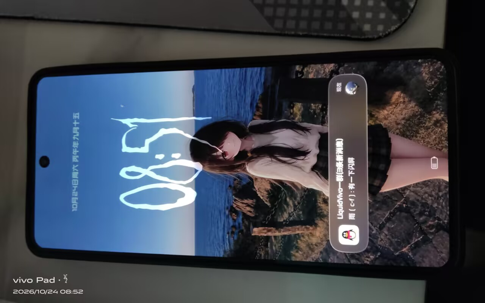
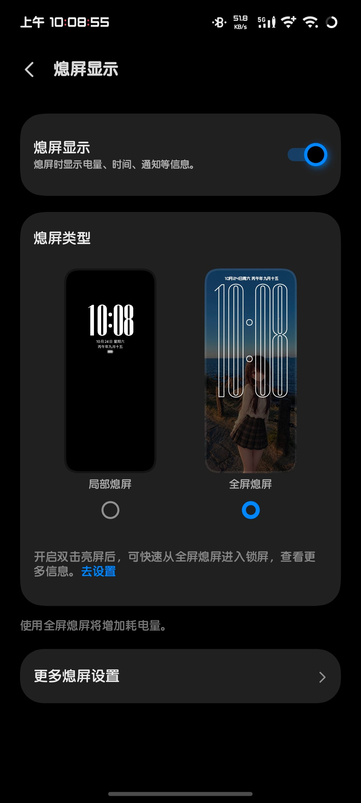

# Neo9SP_aod

> 给 **iQOO Neo9S Pro（PD2339）** 打开被 vivo 藏起来的「**全屏熄屏 / 全天候 AOD**」。




---

## 这是什么

Neo9S Pro 和 iQOO 12 / Neo9 用的是**同一块 8T LTPO 屏**，硬件完全支持"全屏熄屏"——锁屏后把整块锁屏压暗当 AOD 显示（壁纸 + 大时钟 + 通知），但 vivo 在固件里用**机型白名单**把它藏了。

这个项目用两个小模块把它放出来：

| 组成 | 形式 | 干什么 |
|---|---|---|
| `Neo9SP_aod_ksu` | KernelSU 模块 | 开机写属性 `ro.vivo.keyguard_full_aod.enable=1`，并把面板能力文件 `/sys/lcm/aod_disp_info` 修正成 `support_full_screen=1`（可调熄屏亮度） |
| `Neo9SP_aod_lsp` | LSPosed 模块 | 绕过着色器…不是，是绕过「熄屏显示」App 内的机型白名单判断（`r4.h.f0()` 等）与 SystemUI 的全屏判定 |

两个一起用是完整形态；只装 LSPosed 模块也能出效果，但亮度行为不如双模块。



---

## 为什么需要两个模块

`com.vivo.nightpearl`（熄屏显示 8.0.4.2）里，「局部熄屏 / 全屏熄屏」这个选择器的显示条件是：

```java
// r4.h
boolean f0() { return modelNumber >= 2436 && n && x; }   // 机型白名单
boolean e0() { return x; }                               // prop && 版本
boolean Q()  { return contains("support_full_screen=1"); } // 面板能力
```

- `modelNumber` 是从 `ro.vivo.product.model` 里抠的数字：`PD2339 → 2339`，**天生小于 2436**，这一关纯靠改属性/文件过不去；
- 面板能力来自 `/sys/lcm/aod_disp_info`，你机器上是：
  ```
  aod_brightness=956,support_full_screen=0,support_1hz=2,support_video_aod=0,doze_suspend_fps=1
  ```
  也就是驱动直接报"不支持"。

所以：

- **KSU 模块**负责"文件与属性层"（面板串、prop）；
- **LSPosed 模块**负责"Java 层"（白名单三个布尔 + SystemUI 的 `isFullAodType()`）。

只做前者：全屏能亮，但设置里没有选择器、亮度会先压到最暗再抬一档。
只做后者：选择器回来了，但面板串仍报 0，亮度偏暗。

---

## 兼容性

| 项目 | 要求 |
|---|---|
| 机型 | iQOO Neo9S Pro（PD2339 / V2338A） |
| 系统 | OriginOS 6 / Android 16，已在 `PD2339I_A_16.2.13.1.W10.V000L1` 验证 |
| 熄屏显示 | `com.vivo.nightpearl` **8.0.4.2**（KSU 模块的 APK 补丁锁这个版本，其它版本自动跳过） |
| Root | KernelSU（或 Magisk / APatch 亦可加载同格式模块） |
| 框架 | LSPosed（仅 LSP 模块需要） |

> 同代 8T LTPO 机型（Neo9 / iQOO 12 等）理论上同路，但菜单项与 dex 类名可能不同，需要自行适配后 PR。

---

## 安装

### 1. KernelSU 模块

1. 下载 [release/Neo9SP_aod_ksu_v3.0.zip](release/Neo9SP_aod_ksu_v3.0.zip)；
2. KernelSU 管理器 → 模块 → 从本地安装 → 选 zip；
3. **完整重启**。

装完可用模块的「执行 / Action」按钮出诊断报告（机型、面板串、挂载状态、SELinux 拒绝记录、相关 Settings）。

### 2. LSPosed 模块

1. 下载 [release/Neo9SP_aod_lsp_v2.4.apk](release/Neo9SP_aod_lsp_v2.4.apk)；
2. 安装后在 LSPosed 里启用，作用域点「**推荐**」即可（已内置：`com.vivo.nightpearl`、`com.android.systemui`）；
3. 重启。

### 3. 打开开关

设置 → 桌面、锁屏与壁纸 → 熄屏显示 → 熄屏类型 → 选「**全屏熄屏**」。

> 另外：熄屏显示 → 更多熄屏设置 → **显示方式必须选「全天显示」**。选「轻移手机显示 / 定时显示」时，静止一段时间 AOD 会整块熄灭，表现得就像"黑屏了"。

> 锁屏样式建议用「轻尚锁屏」。Origin 锁屏本身会屏蔽全屏熄屏（App 里有明确提示）。

---

## 配置（仅 KSU 模块）

`/data/adb/iqoo_pd2339_fullaod/config.ini`，改完在管理器点「执行 / Action」**立即生效**，无需重启：

| 键 | 默认 | 说明 |
|---|---|---|
| `SUPPORT_FULL_SCREEN` | `1` | 面板串里 `support_full_screen` 的档位，可试 `2` / `3`（内部亮度/过渡分支不同） |
| `AOD_BRIGHTNESS` | 空 | 熄屏亮度档位（原值 956）。觉得暗就填 `1000`～`1023` |
| `PATCH_APK` | `1` | 是否给「熄屏显示」打 dex 补丁（见下文）。`0` = 不打 |
| `AOD_TYPE` | `2` | 直接写 `vivo_keyguard_aod_type`：1=局部 2=融合（本机唯一实时刷新）3=全屏（静态） |
| `SMART_AOD` | 空 | 写 `persist.vivo.phone.smart_aod`，`0` = 关闭智能熄屏（静止也会尝试刷新） |
| `MOUNT_SYSFS` | `1` | 是否伪造面板能力串（`0` = 只写属性，等价 Neo10 模块的做法） |
| `OVERRIDES` | 空 | 任意覆盖面板串键值，例如 `doze_suspend_fps=0` |
| `DISABLE` | `0` | 设 `1` = 撤掉全部改动，退回原厂（快速回滚） |

---

## 工作原理

### KSU 模块

1. `post-fs-data` 阶段 `resetprop ro.vivo.keyguard_full_aod.enable=1`；
2. 把 `/sys/lcm/aod_disp_info` 读出原文、把 `support_full_screen=0` 换成 `1`，**先 `chcon` 成原节点标签再 bind mount**（不 chcon 的话 App 会被 SELinux 拒读，AOD 直接退化成只剩指纹）；
3. `service.sh` 开机末尾复核，防厂商服务回写；
4. 附带 `sepolicy.rule`，放行 `platform_app` / `untrusted_app` 读取该文件。

### LSPosed 模块

只钩 5 个点，没有 UI、没有写文件：

- `com.vivo.nightpearl` 的 `r4.h.Q()` / `e0()` / `f0()` → 恒 `true`
- `com.android.systemui` 的 `VivoAodViewMediator.isFullAodType()` → 恒 `true`
- `SystemProperties.get("ro.vivo.keyguard_full_aod.enable")` → 恒 `"1"`

### 关于 APK 补丁

LSPosed 这条路本质是"进程内改判断"。如果你想彻底不用 LSPosed，KSU 模块还提供了另一条路：
把「熄屏显示」的 `classes.dex` 里 `Q/e0/f0` 三个方法体就地改成 `return true`（指令数不变、余位补 nop、重算 SHA1/Adler32、`zipalign` 对齐），
开机再 bind mount 顶掉 `base.apk`。

补丁包不随模块分发（体积 41MB，且必须与 App 版本严格一致）。自行生成方式见 `tools/patch_apk.py`。

---

## 常见问题

<details>
<summary><b>设置里没有「熄屏类型」？</b></summary>

- 确认 LSPosed 模块已启用、作用域勾了 `com.vivo.nightpearl`；
- 确认「熄屏显示」版本是 8.0.4.2（KSU 补丁只对这个版本生效）；
- 打开一次设置页前，可以先 `killall com.vivo.nightpearl` 让它重读。
</details>

<details>
<summary><b>熄屏先最暗，再亮一点？</b></summary>

面板串与白名单都到位后仍偏暗的话，先调 `AOD_BRIGHTNESS`（1000/1023）试试；
再试把 `SUPPORT_FULL_SCREEN` 改成 `2` 或 `3`。
</details>

<details>
<summary><b>模块刷不进（-911）？</b></summary>

早期版本把 41MB 补丁包塞进了 zip 导致安装器拒绝。v2.x 已拆开，模块只有 **12KB**。
</details>

<details>
<summary><b>熄屏后只有指纹图标？</b></summary>

典型的「改了文件但没对齐 SELinux 标签」：bind mount 的副本标签不是原节点的，App 读不到面板信息。
本项目已用 `chcon` 处理，并在 `chcon` 失败时**宁可不挂载**。
</details>

---

## 卸载 / 回滚

1. 删除 KSU 模块 → 重启（`uninstall.sh` 会先 umount 再清目录与日志，属性只在内存）；
2. LSPosed 里停用模块 → 重启。

想临时关掉全屏但保留模块：`config.ini` 里 `DISABLE=1` + 点 Action。

---

## 目录结构

```
Neo9SP_aod/
├─ README.md
├─ LICENSE
├─ .gitignore
├─ docs/                     # 效果图、BUGS.md、发帖文案 POST.md
├─ lib/                      # 编译期依赖目录（放 xposed-api-82.jar，自行下载）
├─ release/                  # 成品
│  ├─ Neo9SP_aod_ksu_v3.0.zip
│  └─ Neo9SP_aod_lsp_v2.4.apk
├─ ksu/                      # KernelSU 模块源码
│  ├─ module.prop
│  ├─ config.ini
│  ├─ common.sh
│  ├─ post-fs-data.sh
│  ├─ service.sh
│  ├─ action.sh
│  ├─ customize.sh
│  ├─ uninstall.sh
│  ├─ sepolicy.rule
│  └─ README.md
├─ lsp/                      # LSPosed 模块源码（无 Gradle 构建）
│  ├─ AndroidManifest.xml
│  ├─ res/values/arrays.xml  # xposedscope 推荐作用域
│  ├─ assets/xposed_init
│  └─ src/com/dsh/neoaod/Main.java
└─ tools/
   ├─ build-lsp.ps1          # javac → d8 → aapt2 → zipalign → apksigner
   ├─ patch_apk.py           # 就地改写 dex 方法体 + 重算校验
   ├─ mkzip_ksu.py           # 打 KSU 模块 zip（保留 unix 权限位）
   ├─ dexscan.py             # DEX 字符串/类/方法/xref 扫描
   └─ dexdis.py              # 极简反汇编器
```

---

## 构建（进阶）

LSPosed 模块不依赖 Gradle：`javac --release 11` + `d8` + `aapt2 link` + `zipalign` + `apksigner`，
Xposed API 用 Maven 上的 `de.robv.android.xposed:api:82` 作编译期 classpath。
编译产物用 `class_defs` 校验，确保 API 桩类没有被打进 dex。

`tools/patch_apk.py` 的做法：只改 `code_item` 的指令区、`insns_size` 保持不变（多余补 `nop`），
所以不需要重排 DEX 偏移，只需重算 header 的 SHA1 与 Adler32；重打包后必须 `zipalign`，
否则 `resources.arsc` 不对齐会导致 App 加载失败。

---

## 更新日志

| 版本 | 变化 |
|---|---|
| v1.0 | 只做 bind mount，没对齐 SELinux 标签 → AOD 只剩指纹 |
| v1.2 | 加 `chcon`；字符串替换用 sed 且无自检 → 静默失败 |
| v1.3 | 纯 shell 替换 + 建后自检 + 原标签落盘 |
| v1.4 | 面板串可配置（档位 / 亮度 / 开关） |
| v1.5–v1.7 | 尝试 dex 补丁替代 LSPosed；拆包解决模块装不上 |
| **v2.1** | 定名 **Neo9SP_aod**，双模块组合：KSU 管文件与属性，LSPosed 管 Java 白名单 |
| v2.2–v2.7 | 排查「熄屏不刷新」：依次排除 CPU 挂起（wakelock 无效）、SystemUI 强制判定、伪造面板串；发现只有 `type=2` 实时刷新 |
| **v2.8** | 默认 `AOD_TYPE=2`，新增 `SMART_AOD` / `MOUNT_SYSFS` / `OVERRIDES` 开关，配置自动补键 |

---

## 免责声明

- 改的是系统行为与应用 dex，**请自行承担风险**；出问题按上文「卸载 / 回滚」恢复；
- 不要用于任何商业用途；
- 与 vivo / iQOO 官方无关。

## 致谢

- 酷安 @小雨爱分享 —— 适配、测试与踩坑
- 所有在酷安/酷友群分享过全屏 AOD 思路的人

## License

[MIT](LICENSE) —— 可自由使用/修改/再发布，保留署名即可；第三方与归属说明见 [docs/NOTICE.md](docs/NOTICE.md)。

## 实测结论：本机 AOD 只有 type=2 能实时刷新

| AOD 类型 | 现象 |
|---|---|
| 1（局部） | 时钟正常走，非全屏 |
| **2（融合）** | **压暗锁屏 + 实时刷新，等价你要的全屏 AOD** |
| 3（全屏） | 能画出来，但整屏冻结成最后一帧（时钟都不走） |

type 3 冻结的原因是这台机器的固件里没有接"全屏 AOD 的刷新驱动"，属于显示栈差异（Neo10 那代 16.1.x 固件是原生支持的，所以那位作者一个属性就够）。

另外：**静止时 AOD 暂停刷新、拿起手机才恢复**，这是 vivo 的智能熄屏策略——在原厂局部 AOD 上同样存在，不是本模块引入的。
想尝试关闭：`config.ini` 里设 `SMART_AOD=0`，或在 熄屏显示 → 更多熄屏设置 里关掉「智能显示」。
## 已知限制（实测）

> 完整清单、复现步骤与已排除的方向见 **[docs/BUGS.md](docs/BUGS.md)**，欢迎 PR 来修。


| 现象 | 原因 | 说明 |
|---|---|---|
| 进入 AOD 瞬间会黑一下 | 面板从亮屏切到 AOD 时先关一次背光，属显示栈行为 | 已排除 App 动画：把 `MSG_START_KEYGUARD_TO_AOD_ANIMATION` 吞掉仍然黑 |
| `type=3`「全屏」整屏冻结 | 本机固件没接全屏 AOD 的刷新驱动 | 用 `type=2`「融合」代替，效果就是压暗锁屏 |
| 静止时 AOD 暂停刷新，拿起/倾斜才恢复 | vivo 智能熄屏策略（原厂局部 AOD 同样如此） | 可试 `SMART_AOD=0` 或关掉「智能显示」，不保证生效 |
| 熄屏音乐进度不实时 | AOD 音乐卡片由 nightpearl 的 `AodMusicManager` 自己维护，只深度适配 vivo 音乐 / i音乐 | 第三方播放器通常只有歌名 |